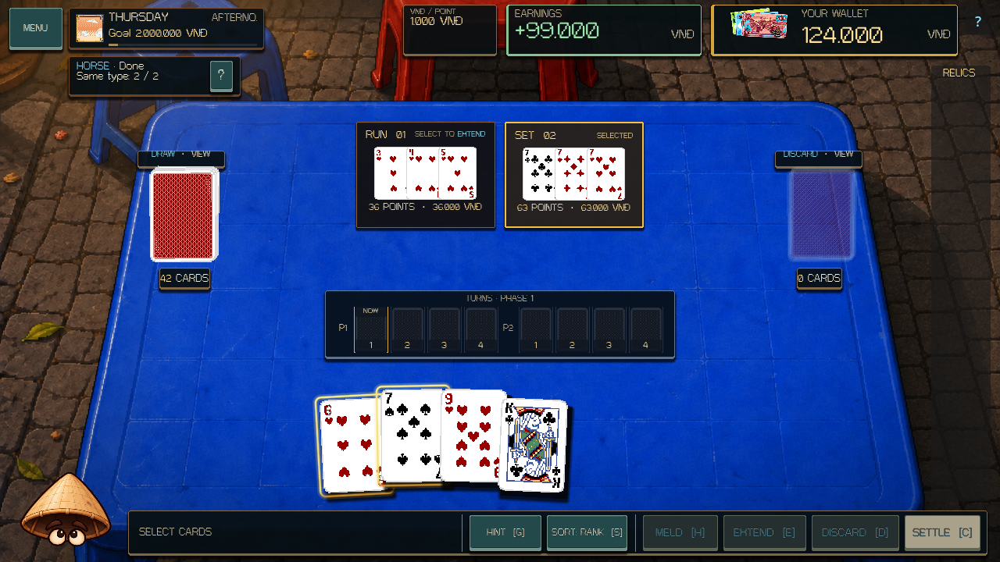
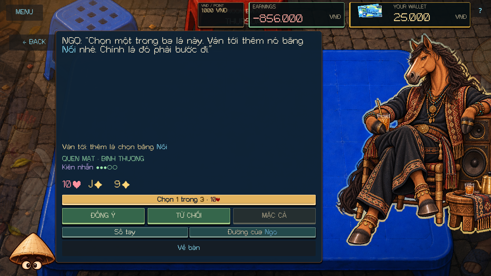
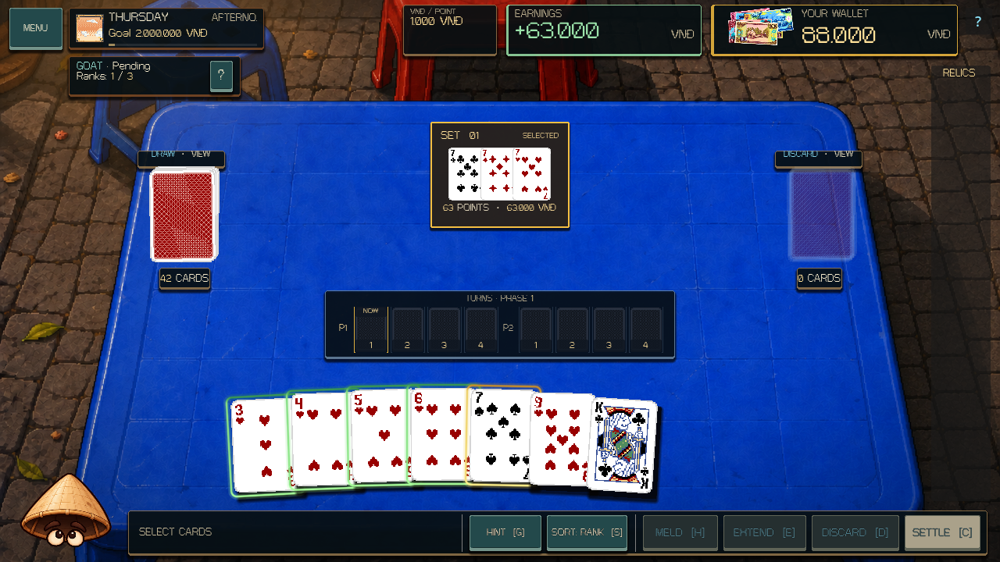
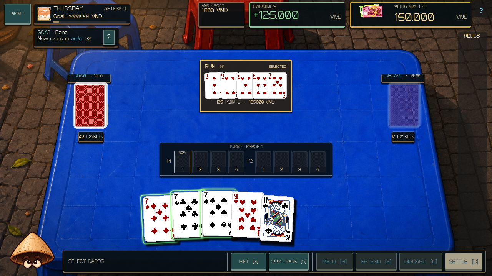
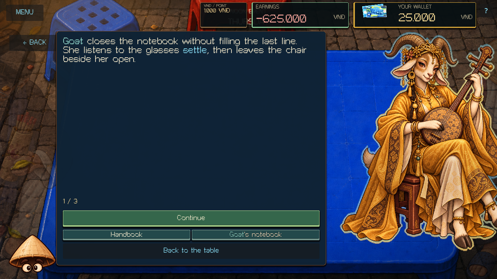

# Horse and Goat - 13 October 2026

Horse and Goat now continue through Kindred using the shared Zodiac persuasion system. Each has twelve explicit English/Vietnamese encounters: three Stranger questions, three Familiar commitments, three Kindred recall encounters, and three personal Kindred questions.

Horse's voice connects freedom with a chosen pace, keeping company, and following through. Goat's voice connects listening with distinct voices, shared phrases, and leaving room for quiet. Their new modules are `scripts/zodiac/content/horse_persuasion.gd` and `goat_persuasion.gd`.

## Commitments

| Boss | Commitment | What fulfills it | Counteroffer |
| --- | --- | --- | --- |
| Horse | A pair of steps | Two successful new Melds or two successful Extensions within one Turn of the next Deal. Mandatory discards and Phase boundaries separate Turns; optional extra discards do not. Failed attempts, previews, and repeated delivery of one action do not add evidence. | Two Meld/Extension actions in the same Turn, in any combination. |
| Horse | Stay with the start | Create the first new Meld of Phase 1, then extend that same Meld before its Turn ends. A later Meld cannot replace it, and a later Turn cannot repair a missed deadline. | Extend that same first Meld in any Turn before Phase 1 settles. |
| Horse | A card's next step | Add the selected physical card to an existing Meld through a successful Extension in the next Deal. Merely playing it in a new Meld or extending a Meld that already contains it does not count. | The player chooses one of three offered cards. Haggle cannot reroll that offer. |
| Goat | Different voices | Score positive points with three different printed ranks across successful Melds/Extensions during the next Deal. Extensions count only newly added cards; repeated ranks count once. Zero-point plays and discarded cards do not count. | Two distinct scoring ranks under the same rule. |
| Goat | A committed phrase | Newly commit at least three different consecutive printed ranks together in one successful Meld/Extension. For Extensions, old Meld cards do not complete the phrase. K and A are not consecutive for this daytime commitment. | Two consecutive newly committed ranks in one action. |
| Goat | A note and its neighbor | Newly commit the selected physical card together with an adjacent printed rank in one successful Meld/Extension. Both cards must be committed in the same action. An old neighbor in the Meld does not count; K and A are not adjacent for this promise. | The player chooses one of three offered cards. Haggle cannot reroll that offer. |

Accept, Refuse, Haggle, and card selection spend no resources or Patience. Acceptance creates a pending obligation. Counteroffers freeze the exact new criteria and require explicit confirmation. Each alternative retains its original semantic commitment kind, so negotiation does not manufacture variety for progression.

The completed Afternoon Deal and the same-day return settle each commitment once. The observer reads actual committed action receipts, native Phase/mandatory-discard boundaries, and physical newly committed cards. It does not move cards, apply scoring, spend money, or alter legal actions.

## Conversation and permanent history

A Pleased judged visit advances Stranger to Familiar. Kindred requires three kept promises across at least two of that character's three commitment kinds, followed by a Normal or Pleased return. The current seeded visit plan stays fixed; a new tier enters on a later encounter.

**Horse's routes** and **Goat's notebook** expose kept, broken, and refused outcomes, the exact past agreement, physical card identities, and progression/Emblem requirements. Each of the three recall topics has separate kept/broken/refused openings. A recall binds its saved memory and survives both newer permanent history and an older checkpoint restore without changing that conversation.

Both characters have an authored Last Chance. An honest pause or limit recovers to one Patience once per visit. An insincere response, or a later zero after recovery, ends the visit.

Their distinct three-page private Emblem scenes require Kindred, three kept promises across two kinds, an honest refusal, a Pleased evening victory, and a subsequent encounter. Existing Emblems and legacy eligibility remain valid. An owned Emblem can prefer Horse or Goat on a future Thursday; the current visitor stays selected.

## Presentation and compatibility

The existing table, supplied portraits, shared card browser, memory panel, and Handbook present the new content. Compact reminders show current Turn-pair or distinct-rank progress, first-Meld follow-through, and chosen-card criteria, with Pending/Done status. The full contract retains the precise deadline and printed-rank interpretation.

The Zodiac service snapshot is version 7. Already-started version-6-or-earlier Horse/Goat visits retain their saved behavior and Normal mood. Pre-Noon checkpoints can enter the new content; later fresh visits use the new system. Earlier pairs' active conversations, promises, memories, and snapshot migrations remain valid.

Horse's evening matching-action/forced-discard rules and Goat's evening rank windows, parity, K-to-A wrap, and payout rules remain unchanged. Goat's daytime consecutive-rank promise explicitly has its own non-wrapping terms. DealState, VndWallet, card services, campaign progression, artwork, tuning, and the six earlier characters' authored content remain authoritative.

## Validation

| Check | Result |
| --- | --- |
| Fresh editor import and main-script parse | Passed; a stale audio-bus UID diagnostic cleared on a fresh import retry without source changes |
| Complete deterministic suite | 493 / 493 tests passed, including 21 new cases |
| Rendered Horse/Goat smoke | 2,004 checks, 0 failures; 30 captures |
| Fresh-process Horse/Goat write / read | 80 + 153 checks, 0 failures across 40 saved states |
| Main runtime, tutorial, campaign, Event Table | Passed |
| Zodiac scene and evening full-roster rules | 106 + 743 checks, 0 failures |
| Evening presentation: main, Dog/Monkey, Pig/Monkey, Horse/Goat | 647 + 717 + 651 + 1,548 headless checks, 0 failures |
| Cat, expanded Cat, Rooster, Monkey/Dog, Pig/Buffalo conversations | 333 + 557 + 809 + 1,912 + 1,954 headless checks, 0 failures |
| Earlier-pair and legacy fresh-process save pairs | Passed |
| Whitespace, unchanged canonical authorities, and preserved prior work | Passed; 118 baseline files outside the expansion compare equal |

All 31 registered feature/regression checks passed. The editor import generated metadata for the six new scripts. Existing OST cue work remains outside this expansion; no staging, commit, push, export, or publication was performed.

The rendered fixture uses actual MatchUI keyboard answers and synthetic pointer input through the conversation buttons, shared physical-card browser, Meld and Extension controls, history, recovery, and private scenes. It checks all twelve encounters and all nine recall openings per character in English/Vietnamese at 1280x720 and 1920x1080. Compact reminder fit is checked in both languages.

Actual two-Phase Deals supply the primary and chosen-card memories. A controlled Goat setup temporarily suspends observation while creating an existing Meld, then uses the real GUI to commit two new consecutive Extension cards; this isolates the old-card boundary of the accepted counteroffer. Controlled permanent histories exercise recall branches, Kindred eligibility, and private-scene prerequisites. The fixture waits for rebuilt controls before clicking them.

Forty run states are written and reopened by separate Godot processes, including partial Turn pairs, distinct ranks, matched and broken outcomes, selected cards, explicit counteroffers, first-Meld deadlines, rank phrases, bound memories, Last Chance, and migrated old visits. Permanent histories are then loaded independently of run checkpoints and checked for Save File isolation.

[Validation manifest](HORSE_GOAT_EXPANSION_VALIDATION_2026-10-13.json) records the final logs, source hashes, preserved prior work, and previews. The evidence covers automated gameplay and rendered synthetic-input checks. It does not establish physical-device input, audio listening, exported-build behavior, or publication.

```powershell
./tools/validate_project.ps1 -Godot <Godot-console-path> -Only parse,core,horse-goat-scene,horse-goat-write,horse-goat-read -RenderedChecks horse-goat-scene -TimeoutSeconds 360
```

## Rendered examples










