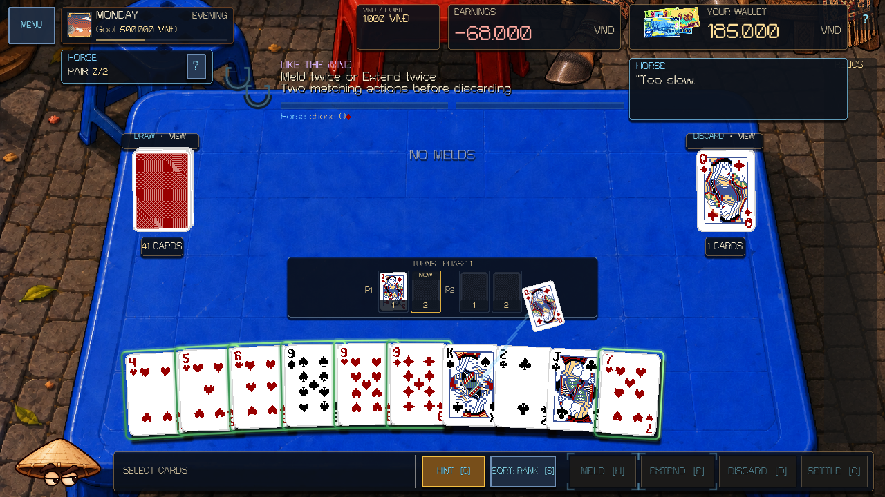
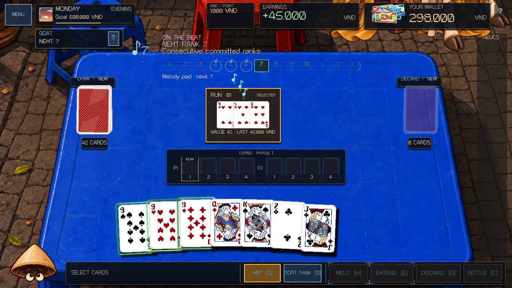

# Horse and Goat fight presentation — 8 October 2026

Horse and Goat, the next scheduled roster pair after Pig/Ox, now explain their mechanics through distinct animated table guides and committed-action reactions. Their original rules, tuning, physical cards, supplied character artwork, wallet, RNG and save format remain authoritative.

## Horse: Like the Wind

- Two procedural horseshoes stamp in as legal matching actions commit. A split blue rail shows the actual pair count; action-button corner cues follow the first chosen action type.
- Two Melds or two Extensions protect the player's discard. Mixing types remains legal and paid, but the guide explains that it did not advance the chosen pair.
- Incomplete pairs show the real remaining grace or random-discard consequence. Actual `horse_grace` events confirm the spared choice; actual `horse_forced_discard` events animate the committed card face from its former hand position to the discard pile with wind trails.
- Protected choices get a blue confirmation. The next turn clears the pair. Hard mode displays the native two-turn limit per Phase.
- Tra Da's optional extra discard receives no invented Horse punishment. The final commit window switches to legal-play and settlement guidance, without demanding another discard pair.

## Goat: On the Beat

- A floating note displays the next authoritative rank. A thirteen-rank staff shows the whole sequence and K → A wrap.
- Paid plays send their unique committed ranks from the Meld into the staff. Extensions animate only the added cards. A real forgiven mistake shows grace consumption; a rank miss produces a red reaction, pays zero and leaves the next rank unchanged.
- Hard mode shows the required turn parity. An unusable next rank turns amber and points to Discard until a matching turn arrives. If the final commit window has no matching turn left, it points to Settle instead.
- The sequence has no timer. Motion illustrates committed rank order rather than inventing a reaction-speed requirement.
- Goat's Meld labels separate intrinsic value from the last recorded payout in `DealState.action_history`. Suppressed plays display their actual zero receipt; successful Extensions display their actual payment. Restore retains those receipts.

## Lifecycle and proof

The new layers read `ZodiacBossRule.presentation()` and committed result/event payloads. Decorations ignore pointer input and never alter button enabled states, payouts, card selection or RNG. Score receipts pause choreography and reaction timers; modals and menus clear transients. Repeated refresh, restore, phase changes and boss switches do not fabricate completion or paid notes. Switching bosses restores the appropriate guide geometry and preserves Pig and Monkey's separate treatment.

The focused fixture instantiates the actual `scenes/match.tscn`, commits real Melds, Extensions and Discards, exercises pointer input through the money receipt, restores snapshots, and checks English/Vietnamese, all three difficulties, and 1280×720, 960×620 and 1920×1080 layouts. It also covers mixed Horse actions, extension pairs, grace exhaustion, forced-card identity, Tra Da extras, Goat parity waits, committed-card-only Extensions, zero payout receipts, K → A wrap and final commit windows.

- `HORSE_GOAT_OVERHAUL_SMOKE checks=1434 failures=0` in headless and rendered OpenGL compatibility runs.
- Previous Pig/Monkey overhaul: `651` checks, zero failures in headless and rendered runs.
- Full-roster presentation: `5417` checks, zero failures in headless and rendered runs.
- Core gameplay: `392/392` passed. Parse and the actual main-scene OpenGL boot are clean; final logs were scanned for engine/script/parse errors.
- All `28` pre-existing tracked diffs outside the authored paths compare equal to the starting baseline. No staging, commit or push was performed.

Run `tools/validate_project.ps1 -Godot <console executable> -Only boss-horse-goat`. Add `-RenderedChecks boss-horse-goat` for rendered checks. The fixture accepts `--capture-motion` when launched directly with a renderer. Raw captures remain under `.godot/horse-goat-overhaul/`.

Actual runtime previews: [Horse's pair and forced-card reactions](screenshots/horse-goat-overhaul-2026-10-08/horse-pair.gif), [Goat's melody, parity wait and wrap](screenshots/horse-goat-overhaul-2026-10-08/goat-melody.gif). GIF playback is abbreviated; the game uses its own frame timing.
