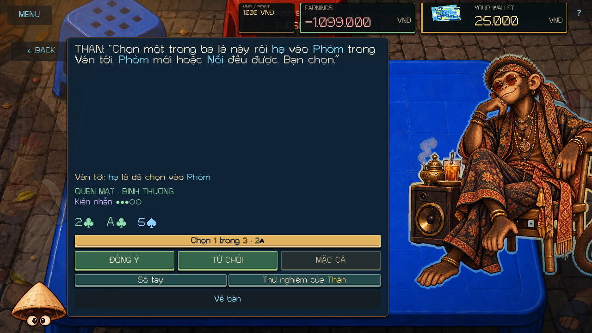
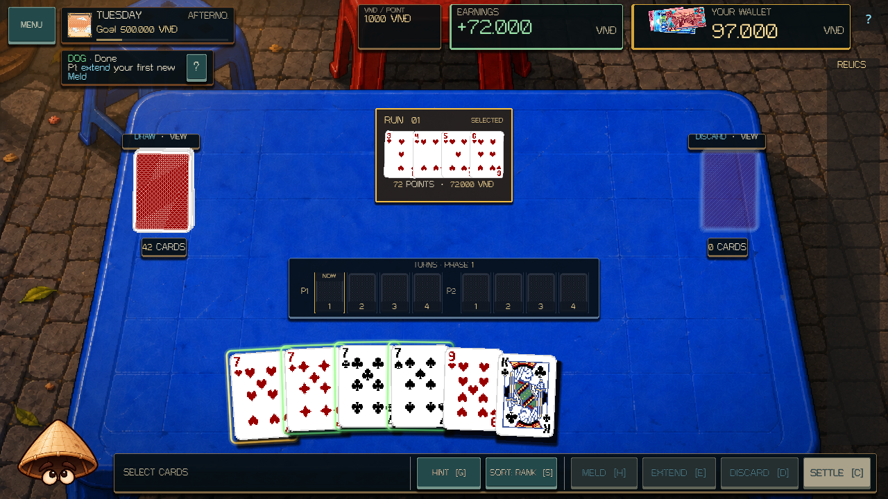
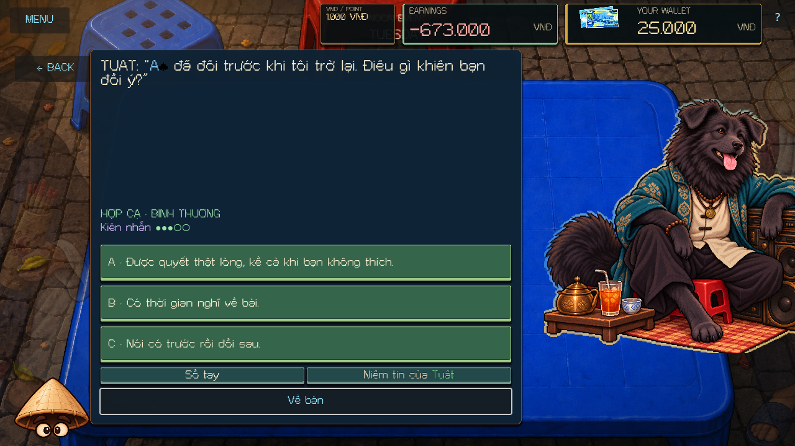
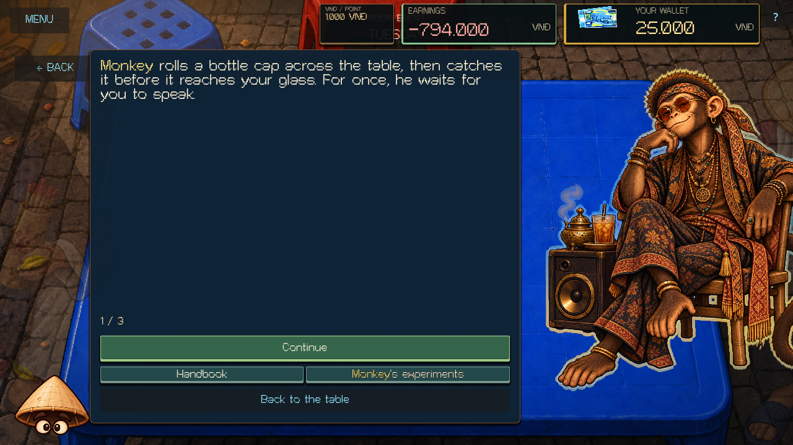

# Monkey and Dog — 12 October 2026

Monkey and Dog now use the same campaign-owned persuasion interpreter as Cat and Rooster. Each has twelve explicit English/Vietnamese encounters: three Stranger questions, three Familiar commitments, three Kindred recall encounters, and three personal Kindred questions. Their dialogue is in `scripts/zodiac/content/monkey_persuasion.gd` and `dog_persuasion.gd`.

Monkey values curiosity, a real attempt, and the freedom to stop a joke. Dog values continuity, a freely given answer, and trust that leaves room for disagreement. They have separate memories, Last Chance exchanges, and three-page private Emblem scenes.

## Commitments

| Boss | Commitment | Actual requirement | Alternative |
| --- | --- | --- | --- |
| Monkey | Change it up | Earn positive points from both a new Meld and an Extension in the next Deal, in either order and across either Phase. Zero-point actions do not count. | One Extension in either Phase. |
| Monkey | One more step | Complete an Extension during either Phase of the next Deal. | Score with both a new Meld and an Extension. |
| Monkey | Your pick | Choose one of three real cards, then commit that physical card into a new Meld or Extension in the next Deal. Swaps and discards do not count. | The player already chooses; Haggle cannot reroll the offer. |
| Dog | Build on it | Create the first new Meld of Phase 1 and extend that same Meld before Phase 1 ends. An Extension to another Meld or in Phase 2 does not fulfill it. | One Extension to any Meld during either Phase. This remains the same commitment kind. |
| Dog | Keep it as it is | Choose one of three real cards and preserve its permanent state until the Afternoon return. Playing or discarding it is allowed. Altering and restoring it still breaks the promise. | The player already chooses; Haggle cannot reroll the offer. |
| Dog | Keep it with you | Retain the selected owned Relic until the Afternoon return. Losing and reacquiring it still breaks the promise. | Another currently owned Relic, shown before explicit acceptance. |

Acceptance reserves an obligation and awards no fulfillment. Refusal, selection, and haggling spend no money, cards, Relics, or Patience. Counteroffers require a new confirmation and cannot be repeated. The exact accepted or refused alternative is remembered.

Only successful committed DealState actions provide action evidence. Previews, failed actions, other Deal periods, and restoration do not count. Card-play promises use committed physical IDs; a card already sitting in a Meld does not count as a newly added card during an Extension. Dog tracks the actual first Meld ID, not its position in a UI list.

The completed Afternoon Deal and same-day return settle each promise once. Pending obligations, partial paid-action variety, first-Meld identity, selected cards, counteroffers, RNG, dialogue, and Patience survive a run save.

## Progression and memory

A Pleased judged visit permanently advances Stranger to Familiar. Familiar to Kindred requires three kept promises across at least two commitment kinds, followed by a Normal or Pleased return. Repeating one kind cannot replace variety. Kindred content begins on a subsequent visit; the current encounter remains the one already selected.

Each visit begins with three Patience. The first zero opens that character's authored Last Chance. An honest boundary can recover to one; an insincere answer ends the visit. A second zero locks the visit. Recovery and judgment resist duplicate input and replay.

**Monkey's experiments** and **Dog's trust** show kept, broken, and refused commitments, concrete remembered cards or Relics, exact action terms, and relationship/Emblem requirements. Recall encounters require a real memory and freeze its result when opened. An older checkpoint cannot replace a newer permanent memory. A recall question displays the past exchange; the next proposed target appears at the commitment step.

The story Emblem route requires Kindred, three kept promises across two kinds, an honest refusal, and a Pleased evening boss victory. Eligibility is evaluated on a subsequent encounter. The private scene grants the Emblem once, and the memory panel then exposes future Tuesday appearance preferences. Existing earned Emblems and legacy unlock eligibility remain valid.

## Compatibility and authority

The Zodiac service snapshot is version 5. RunSave and permanent-profile envelope versions are unchanged. Already-started version-4-or-earlier Monkey/Dog visits finish under their saved behavior, including an old empty visit's Normal difficulty. A pre-Noon checkpoint can enter the new content. The next fresh day uses the new system.

ZodiacService owns the conversation, RNG, observation, and persistence. DealState, permanent card services, Relic ownership, and VndWallet retain their authorities. Both evening boss rules, difficulty tuning, supplied artwork, Cat/Rooster authored content, and the original Cat authority text remain unchanged.

## Validation

| Check | Result |
| --- | --- |
| Fresh editor import and main-script parse | Passed |
| Complete deterministic suite | 449 / 449 tests passed, including 18 new pair tests |
| New rendered Monkey/Dog conversation smoke | 1,934 checks, 0 failures; 22 captures |
| Fresh-process Monkey/Dog write / read | 54 + 105 checks, 0 failures across 28 saved states |
| Main runtime, tutorial, campaign, Event Table | Passed |
| Zodiac scene and evening full-roster rules | 106 + 743 checks, 0 failures |
| Existing Dog/Monkey and Pig/Monkey evening presentation | 717 + 651 headless checks, 0 failures |
| Original Cat, expanded Cat, Rooster conversations | 333 + 557 + 809 headless checks, 0 failures |
| Cat, Rooster, legacy negotiation save pairs | 14 + 44; 17 + 47; 5 + 10 checks, 0 failures |
| Scoped whitespace and unchanged-authority checks | Passed |

The new rendered smoke checks every encounter and all nine recall openings per character in English and Vietnamese at 1280×720 and 1920×1080. It uses the real card browser, keyboard answers, pointer confirmation, Meld target, Meld/Extend controls, complete two-Phase Afternoon Deals, memory panel, Last Chance, and private scenes. Controlled history fixtures cover recall branches and private-scene eligibility; actual GUI promises supply the live action and chosen-card memories.

Separate processes write and reopen 28 run states, then load both permanent character memories independently and verify Save File isolation. The surrounding regression pass covers campaign flow, Event Table, the evening boss roster, original Cat/Rooster content, and their fresh-process save pairs.

[Validation manifest](MONKEY_DOG_EXPANSION_VALIDATION_2026-10-12.json) records the collected checks, final logs, source hashes, and scope. Synthetic input and rendered captures establish these tested flows; physical-device input, audio listening, exported builds, and publication were not part of this pass.

```powershell
./tools/validate_project.ps1 -Godot <Godot-console-path> -Only parse,core,monkey-dog-scene,monkey-dog-write,monkey-dog-read -RenderedChecks monkey-dog-scene -TimeoutSeconds 240
```

## Rendered examples








