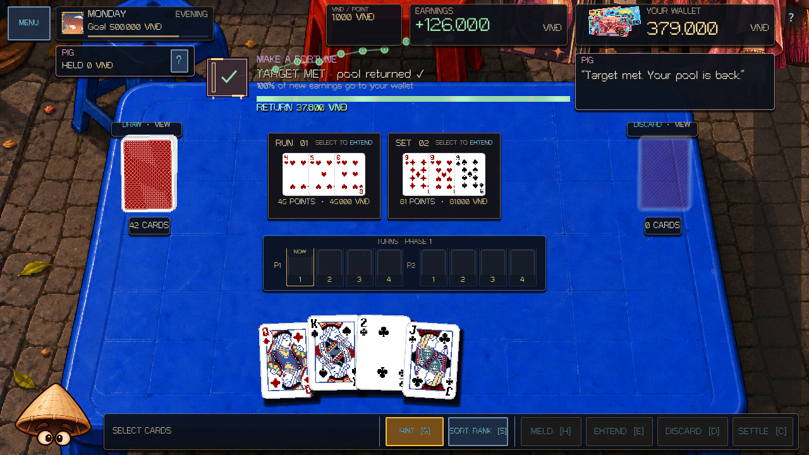
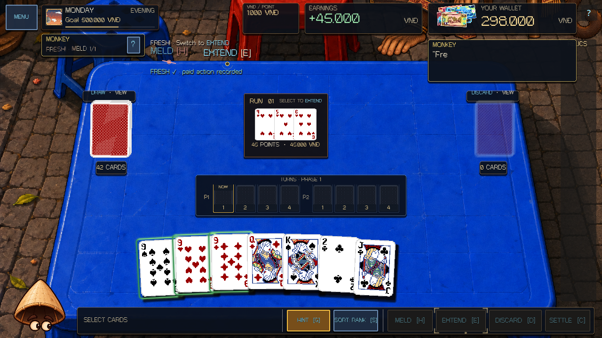

# Pig and Monkey fight presentation — 7 October 2026

Pig's held-money target and Monkey's paid-action rhythm now have distinct animated presentations on the live table. The original boss rules, tuning, payouts, physical cards, save format and supplied character artwork remain authoritative and intact.

## Pig: Make a Fortune

- A procedural vault shows gross-target progress on its wheel. Actual held money forms coin stacks; the vault opens when the real target is met.
- The ledger distinguishes gross earnings from the held pool. It shows the actual siphon split for each difficulty, and the positive-bank loss condition on Unpleased.
- Committed `pig_siphon`, `pig_return` and `pig_bank_loss` events drive sequential coin flights and exact transfer amounts. The target-crossing play can show its final siphon followed by the whole refund.
- The target rail fills smoothly, changes to green on success, and reserves a separate line for return guidance and transfer receipts. A failed hard target shows the amount actually collected.

## Monkey: Fresh and Dance Baby

- Fresh retains its counter in the top-left boss card. Above the Melds, separate Meld and Extend tracks show paid repeat capacity, filled beats and the action that can score next. Discard does not pretend to reset the limit.
- Dance Baby keeps all three localized actions visible above the Melds. A moving conductor follows the authoritative sequence index. Correct actions produce text-local completion sparks; completing the loop gets a distinct confirmation.
- The sequence explicitly says that it checks action order and has no timer. A miss stays legal, pays zero and leaves the required step in place.
- Animated corner cues point to the normal action buttons. A missed scoring action gets a red reaction. Successful Dance scoring replaces obsolete miss speech with the current next action.

## Lifecycle and validation

All new visuals read `ZodiacBossRule.presentation()` and committed action/event payloads. They do not change the wallet, RNG, legal actions or score. Existing button enabled states and card input remain owned by the table. Score receipts pause the choreography; modals and menus clear transient effects; restore and repeated refresh do not invent income or completion. Boss switching clears the pair-specific layers and restores the next boss's guide geometry.

The focused fixture instantiates the actual `scenes/match.tscn`, commits real Melds, Extensions and Discards, exercises pointer input through the money queue, restores snapshots, and checks all three difficulties in English and Vietnamese at 1280×720, 960×620 and 1920×1080. Rendered evidence uses the installed Godot 4.7.1 OpenGL compatibility backend. The project's renderer setting is unchanged.

- Focused overhaul: `PIG_MONKEY_OVERHAUL_SMOKE checks=651 failures=0` in rendered and headless runs.
- Existing Dog/Monkey presentation regression: `709` checks, zero failures in rendered and headless runs.
- Full-roster presentation regression: `5417` checks, zero failures.
- Core gameplay suite: `392/392` passed.
- Clean parse and main-scene boot checked; logs scanned for script, parse and engine errors.
- Pre-existing tracked changes were compared against the starting diff and preserved.

Run the focused check with `tools/validate_project.ps1 -Godot <Godot console executable> -Only boss-pig-monkey`. Add `-RenderedChecks boss-pig-monkey` for rendered checks. The fixture also accepts `--capture-motion` when launched directly with a renderer; raw captures stay under `.godot/pig-monkey-overhaul/`.

Actual rendered animation previews: [Pig's money flow](screenshots/pig-monkey-overhaul-2026-10-07/pig-money.gif), [Monkey's step and loop reactions](screenshots/pig-monkey-overhaul-2026-10-07/monkey-dance.gif). GIF playback is an abbreviated capture; live animations use the game's frame timing.
