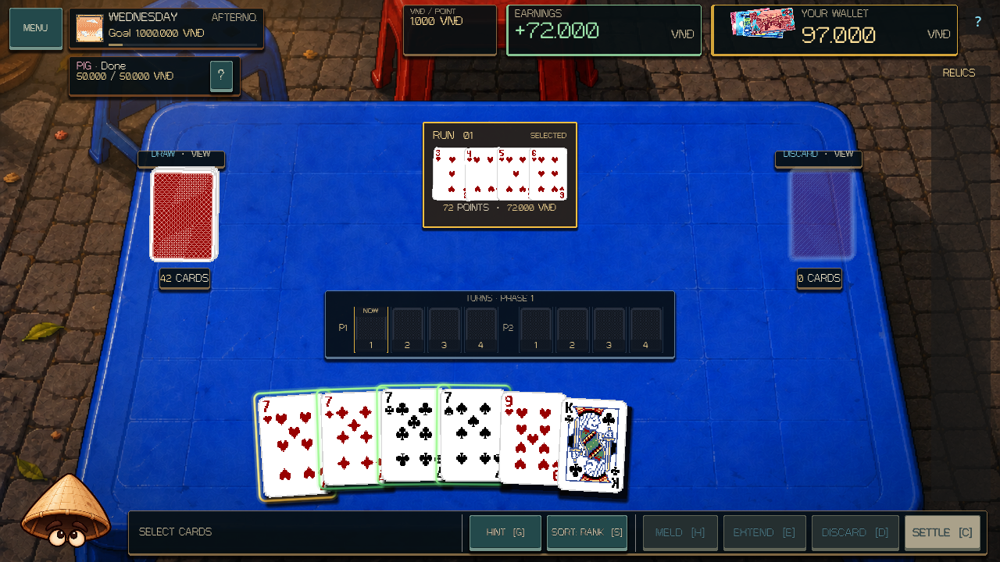
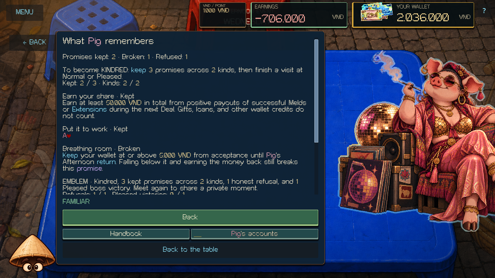
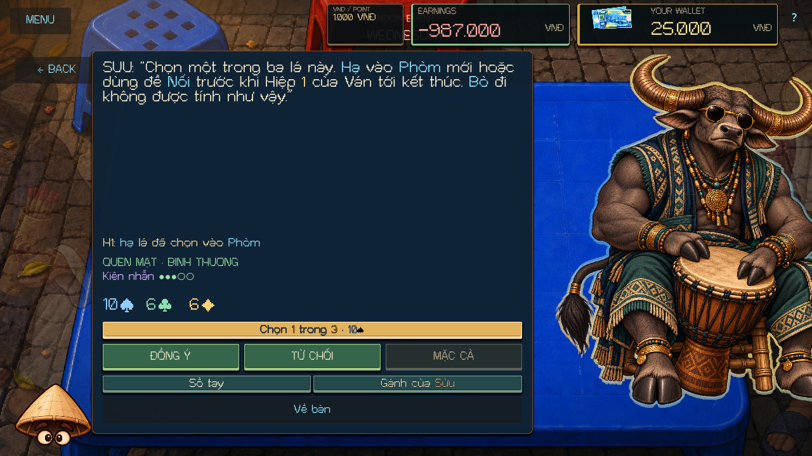
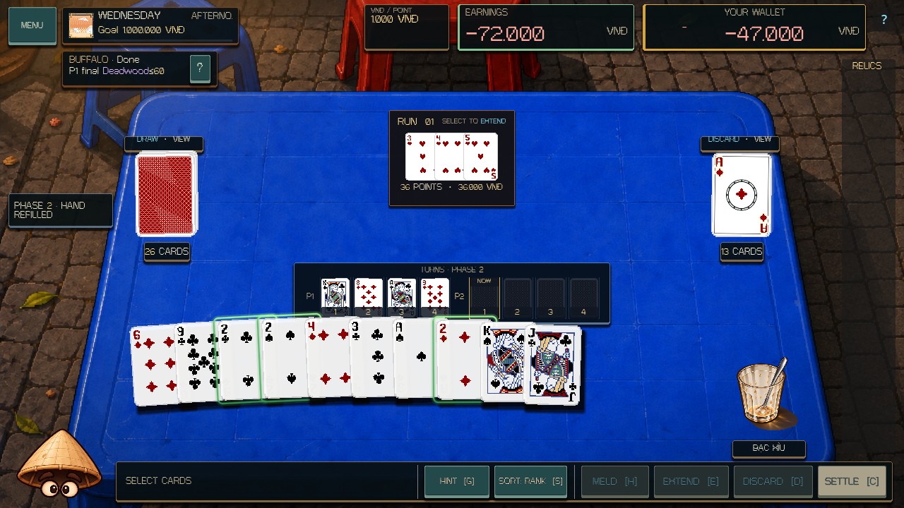
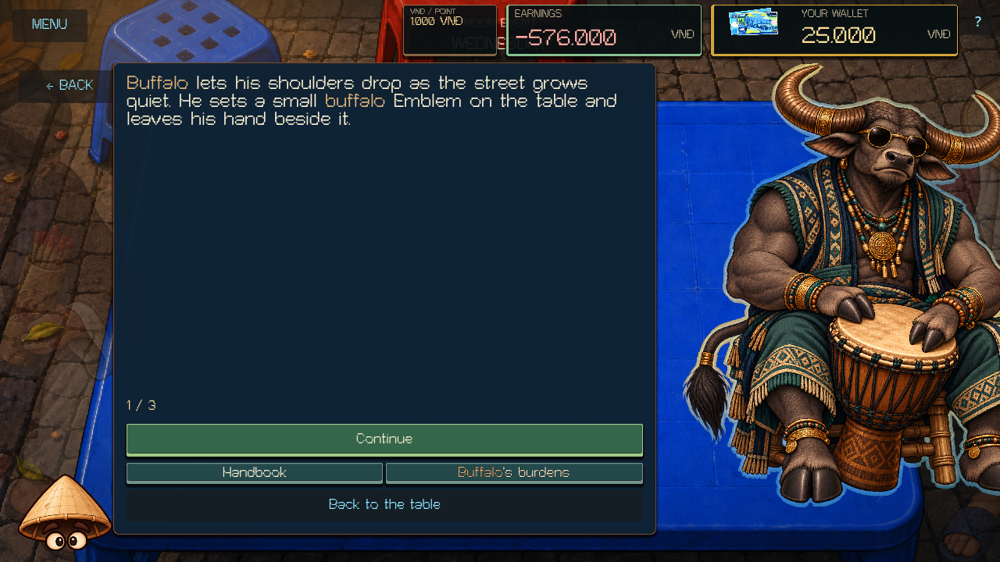

# Pig and Buffalo — 12 October 2026

Pig and Buffalo now continue through Kindred using the shared Zodiac persuasion system. Each has twelve explicit English/Vietnamese encounters: three Stranger questions, three Familiar commitments, three Kindred recall encounters, and three personal Kindred questions.

Pig's voice connects generosity with honest limits and financial security. Buffalo's voice connects work with manageable burdens, rest, and asking for help. Their content lives in `scripts/zodiac/content/pig_persuasion.gd` and `ox_persuasion.gd`; the existing `ox` ID remains the canonical Buffalo identity.

## Commitments

| Boss | Commitment | What fulfills it | Counteroffer |
| --- | --- | --- | --- |
| Pig | Earn your share | At least 50.000 VND from positive net payouts of successful Melds/Extensions in the next Deal. Uses actual action receipts, including the configured VND rate. Gifts, loans, Black Ink credits from discards, and other wallet credits do not count. | 25.000 VND under the same rule. |
| Pig | Breathing room | Wallet remains at least 10.000 VND from acceptance through the Afternoon return. A dip followed by a refund or later earnings still breaks the promise. It is offered and accepted only when the current balance supports the shown reserve. | 5.000 VND through the same return. |
| Pig | Put it to work | The selected physical card enters a new Meld or Extension that actually pays positive VND in the next Deal. Discards, swaps, zero payouts, and merely already being in a Meld do not count. | The player already chooses one of three cards; Haggle cannot reroll the offer. |
| Buffalo | A manageable load | At the next Deal's Phase 1 settlement, the final loose-card Deadwood penalty is at most 30 PTS. Reads `PhaseSettlement.deadwood_penalty`, excludes earlier Turn penalties, and does not let Black Ink profit cancel the measured penalty. | At most 60 PTS under the same settlement rule. |
| Buffalo | Finish with help | At least one actual Extension during Phase 2 of the next Deal. An earlier Phase 1 Extension does not fulfill the original contract. | One Extension in either Phase. |
| Buffalo | Set it down | The selected physical card enters a new Meld or Extension during Phase 1 of the next Deal, including its final commitment window. Discards, swaps, and Phase 2 plays do not count. | The player already chooses one of three cards; Haggle cannot reroll the offer. |

Accept, Refuse, Haggle, and card selection spend no resources or Patience. Acceptance reserves an obligation; it does not fulfill it. A counteroffer states its new amount or deadline and requires explicit confirmation. Alternatives retain the same semantic commitment kind, so negotiation cannot manufacture variety for progression.

The completed Afternoon Deal and same-day return settle each commitment once. Wallet breaches observe only published VndWallet changes; a rejected atomic transaction leaves the reserve intact. Read-only previews and failed actions provide no action evidence.

## Conversation and permanent history

A Pleased judged visit advances Stranger to Familiar. Kindred requires three kept promises across at least two of that character's three commitment kinds, followed by a Normal or Pleased return. A permanent tier never falls because of one difficult visit. Kindred content enters on a subsequent visit; the current seeded plan stays fixed.

**Pig's accounts** and **Buffalo's burdens** show kept, broken, and refused commitments, exact past terms, physical card identities, and progression/Emblem requirements. Each recall topic has distinct kept/broken/refused openings and requires a real settled memory. Bound recalls cannot change when a newer profile entry arrives or an older checkpoint is loaded.

Both characters have an authored Last Chance. An honest limit recovers to one Patience once per visit. An insincere answer, or a later zero after recovery, ends the visit.

Their three-page private Emblem scenes require Kindred, three kept promises across two kinds, an honest refusal, a Pleased evening boss victory, and a subsequent encounter. Existing earned Emblems and legacy unlock eligibility remain valid. Owned Emblems can prefer that character on a future Wednesday; today's visitor stays the one already selected.

## Presentation, authority, and compatibility

The table uses compact action/amount/deadline reminders and the existing Handbook for full contracts. Pig's cash counter displays progress capped at the goal, while the interpreter, wallet, and Handbook retain the full earned amount. Buffalo's reminder retains the final Phase 1 settlement boundary. Remembered questions keep the proposed next target hidden until the commitment step.

A rendered regression exposed an old-Phase setup event incorrectly closing a new Phase 1 card commitment. The interpreter now enables Deal observations after the actual `start_deal` / `start_tutorial_deal` event and accepts committed gameplay actions as evidence. A Drink setup event referring to Phase 2 of the preceding Deal cannot break the new promise. The guard also covers next-Deal card-use observations. Older active promises without the additive readiness field retain their recorded behavior.

The Zodiac service snapshot is version 6. Already-started version-5-or-earlier Pig/Buffalo visits finish under their saved behavior, including an old empty visit's Normal mood. Pre-Noon checkpoints can enter the new content; a later fresh day uses the new system. Monkey/Dog version-5 conversations remain valid.

DealState, VndWallet, card services, Relic ownership, and campaign transitions retain their authorities. Pig/Buffalo evening mechanics, tuning, artwork, original Cat authority text, and the four earlier characters' authored modules remain intact.

## Validation

| Check | Result |
| --- | --- |
| Fresh editor import and main-script parse | Passed |
| Complete deterministic suite | 472 / 472 tests passed, including 23 new cases |
| New rendered Pig/Buffalo smoke | 1,982 checks, 0 failures; 28 captures |
| Fresh-process Pig/Buffalo write / read | 81 + 153 checks, 0 failures across 40 saved states |
| Main runtime, tutorial, campaign, Event Table | Passed |
| Zodiac scene and evening full-roster rules | 106 + 743 checks, 0 failures |
| Evening presentation: main, Dog/Monkey, Pig/Monkey | 647 + 717 + 651 headless checks, 0 failures |
| Cat, expanded Cat, Rooster, Monkey/Dog conversations | 333 + 557 + 809 + 1,912 headless checks, 0 failures |
| Earlier-pair and legacy fresh-process save pairs | Passed |
| Whitespace, preserved-authority, and prior-work checks | Passed |

The rendered fixture checks all twelve encounters and all nine recall openings per character in English and Vietnamese at 1280×720 and 1920×1080. It uses keyboard answers, pointer confirmation, the shared card browser, actual Meld/Extend/SettLe controls, complete two-Phase Deals, memory panels, Last Chance, and private scenes. The settlement flow awaits the live Phase transition before advancing its fixture.

Controlled history fixtures cover recall branches and private-scene eligibility. A controlled Black Ink hand exercises the actual settlement receipt; it is not presented as a normal seeded opening. Live GUI action and chosen-card promises supply the actual remembered results.

Separate processes write/reopen forty run states, including counteroffers, partial earnings, Phase 2 work, wallet breach/refund evidence, settlement penalties, card deadlines, bound recalls, Last Chance, and migrated old visits. Permanent histories are then loaded independently of run checkpoints and checked for Save File isolation.

[Validation manifest](PIG_OX_EXPANSION_VALIDATION_2026-10-12.json) records final logs, source hashes, preserved prior work, and captured previews. These are automated and rendered results with synthetic input; physical-device input, audio listening, exported builds, and publication were not part of this pass.

```powershell
./tools/validate_project.ps1 -Godot <Godot-console-path> -Only parse,core,pig-ox-scene,pig-ox-write,pig-ox-read -RenderedChecks pig-ox-scene -TimeoutSeconds 240
```

## Rendered examples










