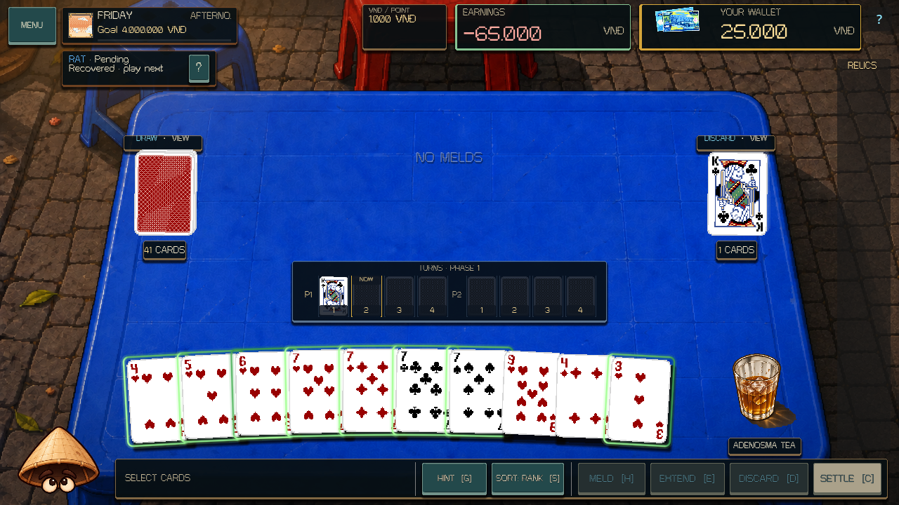
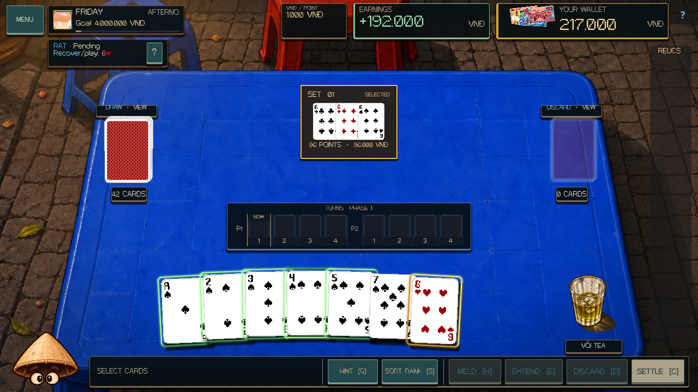
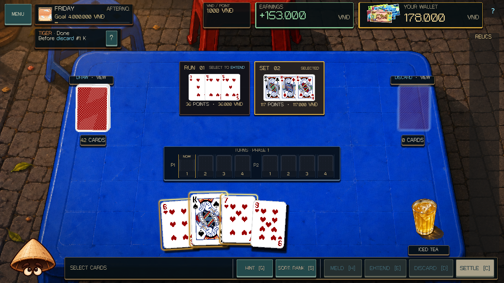
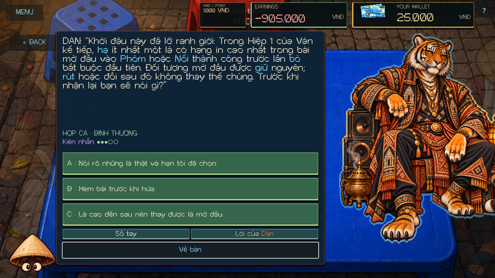
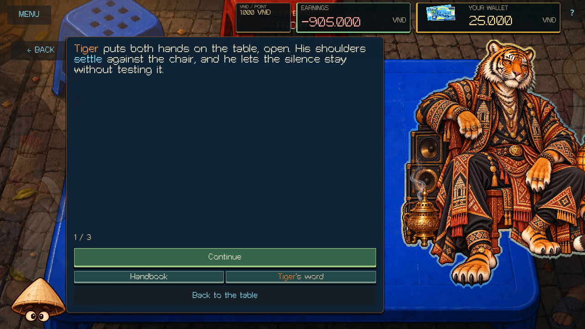

# Rat and Tiger - 13 October 2026

Rat and Tiger now continue through Kindred using the shared Zodiac persuasion system. Each has twelve explicit English/Vietnamese encounters: three Stranger questions, three Familiar commitments, three Kindred recall encounters, and three personal Kindred questions.

Rat's voice connects resourcefulness with useful returns, keeping track of real things, and respecting ownership. Tiger's voice connects strength with a chosen commitment, clear boundaries, and the ability to hear an honest no. Their modules are `scripts/zodiac/content/rat_persuasion.gd` and `tiger_persuasion.gd`. Rat retains the established `rat` identity and supplied `mouse` artwork paths.

## Commitments

| Boss | Commitment | What fulfills it | Counteroffer |
| --- | --- | --- | --- |
| Rat | A useful return | Use Nhân Trần or Đen Đá to recover a physical card from this Deal's discards, then commit that same card in a successful Meld/Extension during the next Deal. Draws, the swap-out card, another card, or a play before recovery do not count. | Allow Nước Vối and Nâu Đá recoveries from Melds as well as discard swaps, still followed by a later play of the same physical card. |
| Rat | New pieces | Newly add two different physical cards through successful Extensions during the next Deal. They may enter different Melds or Phases. Recovering and adding the same card again counts once; old Meld cards do not count. | One newly added physical card. |
| Rat | The real thing | Choose one of three cards, recover that exact physical card with one of the four recovery Drinks during the next Deal, then newly commit it in a successful Meld/Extension. Its initial play does not fulfill the later replay. | The player already chooses the physical card; Haggle cannot reroll the offer. |
| Tiger | Stand behind the opening | Before the first mandatory discard in Phase 1 of the next Deal, commit at least one physical card with the highest printed rank in the actual opening hand in a successful Meld/Extension. Every tied highest card is eligible. Targets bind once on the real start event; draws, swaps, value bonuses, and later cards do not replace them. | Keep the original opening targets but allow any Turn before Phase 1 settles. |
| Tiger | Commit the group | Commit a new Meld of at least four physical cards together during the next Deal. Growing a smaller Meld through an Extension does not change its original size. | A new Meld of at least three cards. |
| Tiger | Own the choice | Commit the selected physical card with at least three other cards in one successful new Meld during the next Deal. A three-card beginning, an Extension, or a similar substitute card does not count. | The player already chooses one of three offered cards; Haggle cannot reroll the offer. |

Accept, Refuse, Haggle, and selection spend no resources or Patience. Acceptance creates a pending obligation. Each counteroffer freezes its new criteria and requires explicit confirmation; it retains the original semantic commitment kind for progression.

The completed Afternoon Deal and same-day return settle each commitment once. The observer reads actual Drink recovery receipts and newly committed physical card IDs. Tiger's targets bind to the real opening hand after setup is complete, and the accepted deadline remains fixed. It does not change legal actions, scoring, wallet transactions, physical movement, or RNG.

## Conversation and permanent history

A Pleased judged visit advances Stranger to Familiar. Kindred requires three kept promises across at least two of that character's three commitment kinds, followed by a Normal or Pleased return. The current seeded plan stays fixed; a new tier enters on a later encounter.

**Rat's finds** and **Tiger's word** show kept, broken, and refused outcomes, the exact accepted agreement, physical choices, and progression/Emblem requirements. Each of the three recall topics has distinct kept/broken/refused openings. Bound recalls survive newer permanent memory and older checkpoint restore without changing the current conversation.

Tiger's accepted opening targets survive checkpoints as physical-ID arrays. Settled memory stores their ID-to-label map and localized target descriptions using the existing permanent-profile dictionary grammar. No change to MetaSaveFiles or RunSave is needed.

Both characters have an authored Last Chance. An honest limit recovers to one Patience once per visit. An insincere answer, or a later zero after recovery, ends the visit.

Their distinct three-page private Emblem scenes require Kindred, three kept promises across two kinds, an honest refusal, a Pleased evening victory, and a subsequent encounter. Existing Emblems and legacy eligibility remain valid. Owned Emblems can prefer Rat or Tiger on a future Friday; today's visitor stays selected.

## Presentation and compatibility

The existing table, supplied portraits, shared card browser, memory panel, and Handbook present the new content. Compact bilingual reminders distinguish a recovered card still waiting for its later play, distinct Extension-card progress, the bound opening rank, and the required new group. The full contract preserves Drink sources, physical identity, and deadlines.

The Zodiac service snapshot is version 8. Already-started version-7-or-earlier Rat/Tiger visits retain their saved behavior and Normal mood. Pre-Noon checkpoints can enter the new content; later fresh visits use the new system. Earlier pairs' active conversations, promises, memories, and migrations remain compatible.

Rat's evening discard response, borrowing, boss-owned Melds, and Extension payments remain unchanged. Tiger's evening hand snatches and both bosses' Exhaustion rules remain unchanged. DealState, VndWallet, CampaignManager, card services, permanent-profile/run-save authorities, tuning, artwork, and the eight earlier characters' authored content remain intact.

## Validation

| Check | Result |
| --- | --- |
| Fresh editor import and main-script parse | Passed; an initial audio-bus UID diagnostic cleared on a fresh import retry without source changes |
| Complete deterministic suite | 516 / 516 tests passed, including 23 new cases |
| Rendered Rat/Tiger smoke | 2,015 checks, 0 failures; 31 captures |
| Fresh-process Rat/Tiger write / read | 93 + 181 checks, 0 failures across 44 saved states |
| Main runtime, tutorial, campaign, Event Table | Passed |
| Zodiac scene and evening full-roster rules | 106 + 743 checks, 0 failures |
| Evening presentation: main, Dog/Monkey, Pig/Monkey, Horse/Goat, Rat/Tiger | 647 + 717 + 651 + 1,548 + 882 headless checks, 0 failures |
| Cat, expanded Cat, Rooster, Monkey/Dog, Pig/Buffalo, Horse/Goat conversations | 333 + 557 + 809 + 1,912 + 1,954 + 1,974 headless checks, 0 failures |
| Earlier-pair and legacy fresh-process save pairs | Passed |
| Whitespace, unchanged canonical authorities, and preserved prior work | Passed; 148 baseline files outside this expansion compare equal |

All 35 registered feature/regression checks passed. The editor import generated metadata for the six new scripts. Existing OST cue work remains outside this expansion. No staging, commit, push, export, or publication was performed.

The rendered fixture uses actual MatchUI keyboard answers and synthetic pointer input through conversation buttons, the shared card browser, Meld/Extension controls, history, Last Chance, and private scenes. It checks all twelve encounters and all nine recall openings per character in English/Vietnamese at 1280x720 and 1920x1080. Compact reminder fit is checked in both languages.

Controlled physical openings use exactly one actual DealState start. The fixture temporarily replaces the UI's automatic Deal-request initialization so Tiger's opening obligation cannot bind to an earlier random hand; campaign preparation and the actual start event remain authoritative. It restores the normal callback immediately. Drink swaps and card recoveries use committed DealState APIs; the later scoring plays use the real GUI controls. Actual two-Phase Deals provide the primary and chosen-card memories. Controlled permanent histories cover recall branches and private-scene eligibility.

Forty-four run states are written and reopened by separate Godot processes, covering partial recovery and replay, selected cards, distinct additions, fixed opening targets, missed deadlines, group size, explicit counteroffers, bound recall, Last Chance, and migrated old visits. Resumed partial card obligations are completed through actual recovery/creation/Extension actions. Permanent histories are loaded independently of run checkpoints and checked for Save File isolation.

[Validation manifest](RAT_TIGER_EXPANSION_VALIDATION_2026-10-13.json) records final logs, source hashes, preserved prior work, and previews. The results prove automated gameplay and rendered synthetic-input behavior. They do not establish physical-device input, audio listening, exported-build behavior, or publication.

```powershell
./tools/validate_project.ps1 -Godot <Godot-console-path> -Only parse,core,rat-tiger-scene,rat-tiger-write,rat-tiger-read -RenderedChecks rat-tiger-scene -TimeoutSeconds 360
```

## Rendered examples










