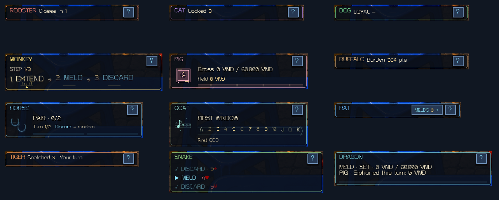
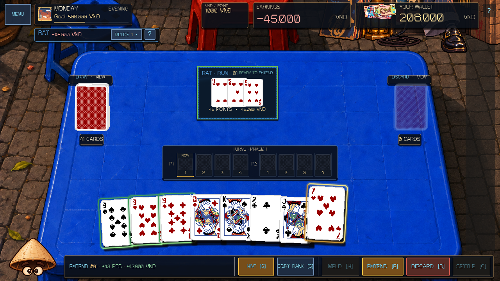
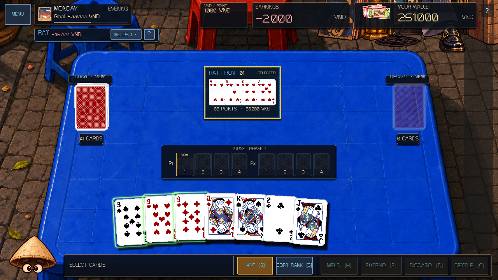
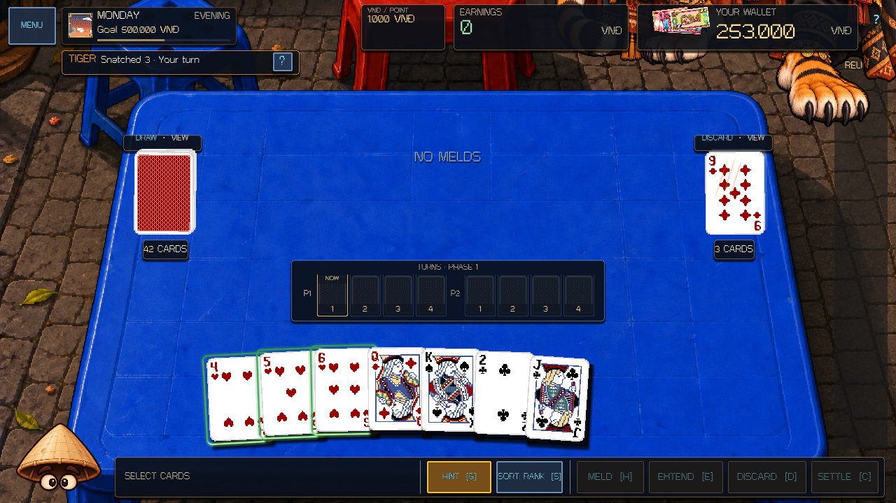

# Zodiac table and HUD update — 8 October 2026

All twelve bosses share a compact status header beneath DAY, with the same name and right-aligned **?** control. Rat, Tiger, Rooster, Cat, Dog and Buffalo need only a 35-pixel row. Pig, Horse, Goat, Monkey, Snake and Dragon add space for their active mechanic. Width follows the content; the Meld lane reserves the actual occupied height. Skill slogans and repeated rule explanations are removed from the visible HUD. Full rules remain behind **?**.

## Rat's real table Melds

Rat's blue palette matches the supplied character art. Boss-owned Melds appear on the normal table with a blue title, animated ownership rim and sheen. Rat-added cards in player Melds retain their individual blue shader and stamp. Marks follow committed card IDs through save/restore.

Players can select or drag cards onto Rat's Melds and use **Extend**. Preview, advice, legal targets and commit all use the authoritative combined table. Extensions pay the normal added-score delta through the existing scoring pipeline, including applicable milestones and relic bonuses. Rat retains ownership; boss Melds remain unavailable for Drink recovery.

The captured Run grows from 4–5–6 (45 points) to 4–5–6–7 (88 points). The preview and wallet both show a **43,000 VND** payment. Rat's previous deduction stays in its compact receipt.

**MELDS** opens an optional collection overview; the physical Melds remain on the table when it is closed. Transfers land on their actual table cards. Unused loans return concealed.

## Tiger and existing rules

Tiger shows the complete refill for 1.65 seconds before the paw and claw swipe. Removed cards fly into the discard pile; input returns after the true hand settles. Its HUD shows only the current attack state or snatched count, with no empty mechanic body.

Rat and Tiger remove the Exhaustion bonus on all difficulties while retaining physical recycling. Goat accepts a three-rank window and advances it by three after a paid play, such as 4/5/6 → 7/8/9. English names use **Rat** and **Buffalo**; existing save and asset identifiers remain compatible.

## Verification

Godot 4.7.1, isolated profiles, English/Vietnamese, all difficulties and 960×620, 1280×720 and 1920×1080:

- Core rules: **396/396**.
- Rendered Rat/Tiger: **882 checks, 0 failures**.
- Rendered full roster: **5,755 checks, 0 failures**, including shared rule-button alignment.
- Rendered Horse/Goat: **1,508/0**; Pig/Monkey: **651/0**; Dog/Monkey: **717/0**.
- Parse, rendered runtime scene, physical card interaction and boss money presence passed.
- The actual main scene launched in OpenGL compatibility, ran 120 frames and exited without Godot errors.
- The fresh screenshot fixture verifies the actual Rat Run payment and renders every boss.

Run `tools/validate_project.ps1 -Godot <console executable> -Only boss-rat-tiger -RenderedChecks boss-rat-tiger` for focused scene checks. Changes remain local; no commit or push was requested.
