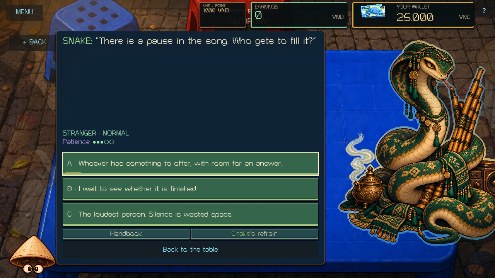
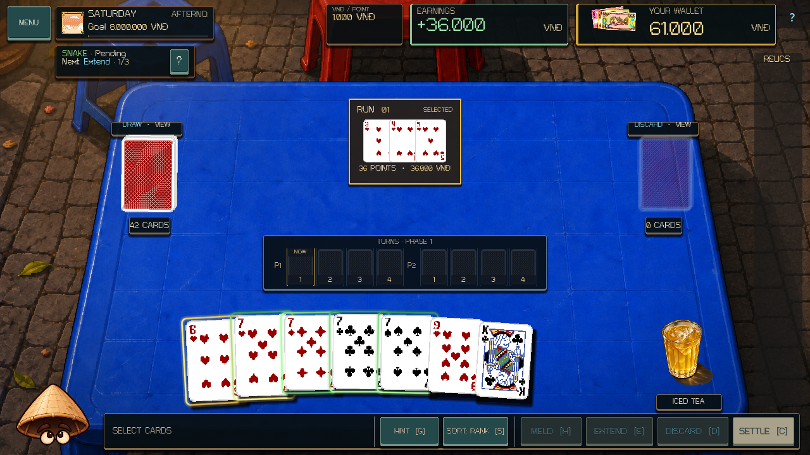
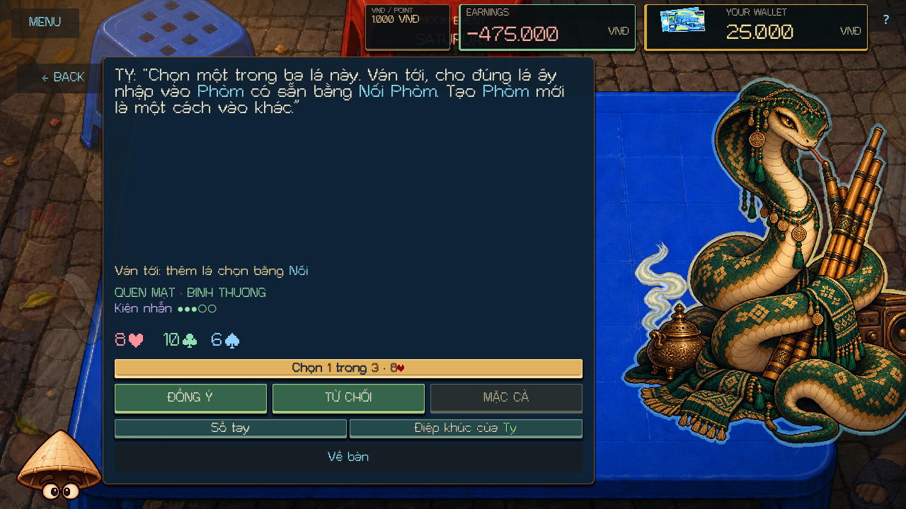
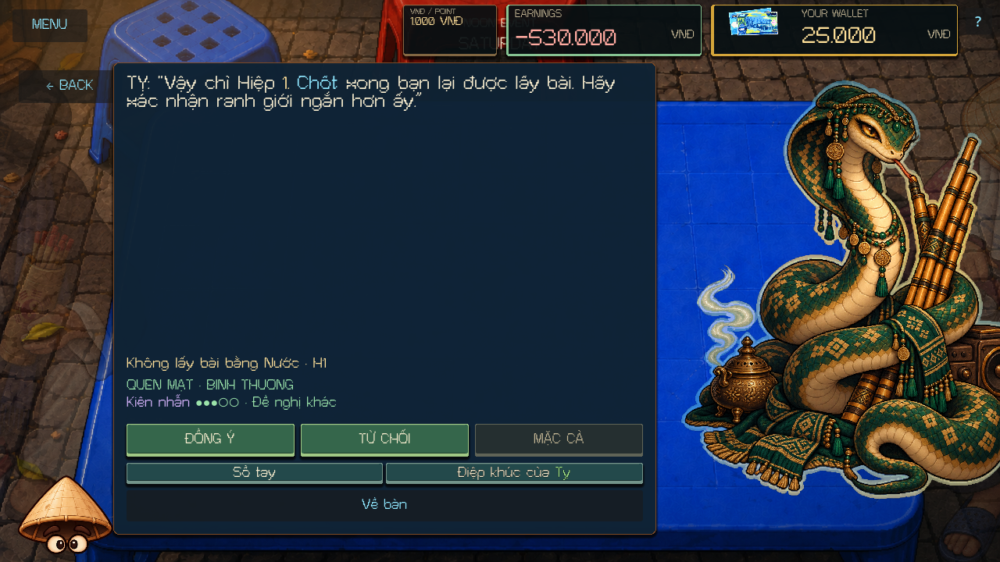
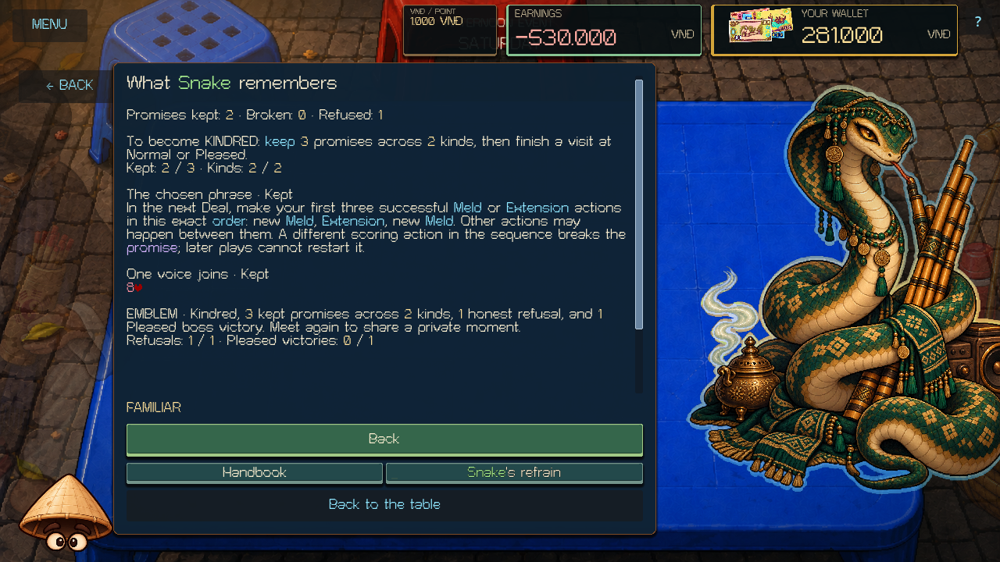
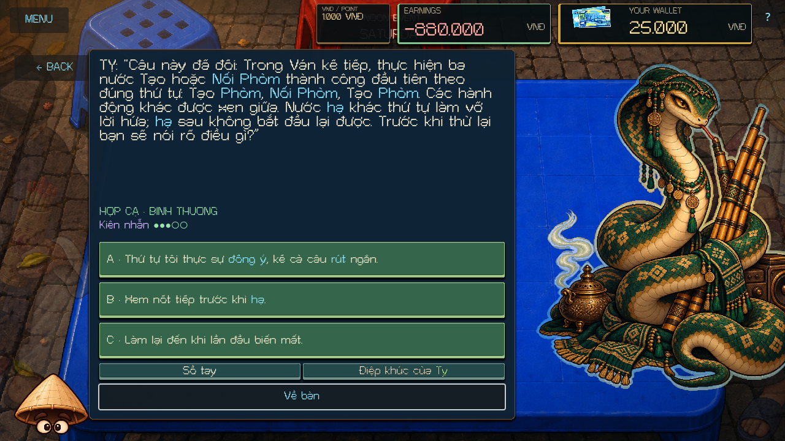
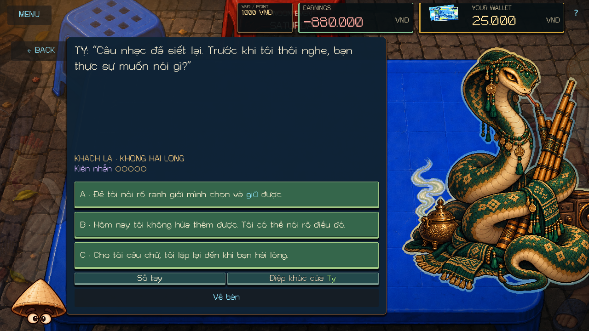
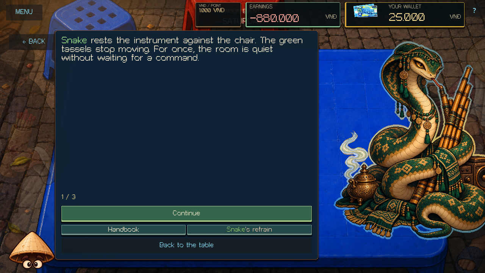

# Snake expansion — 2026-10-13

Snake now has a complete bilingual daytime arc from Stranger through Kindred, using the shared persuasion system already used by Cat, Rooster, and the other expanded visitors. Snake remains the Saturday visitor. The authored voice follows the supplied musician artwork: chosen phrases, precise terms, pauses, and the difference between an invitation and a command.

## Authored conversations and progression

[Snake's content](../scripts/zodiac/content/snake_persuasion.gd) contains twelve explicit English/Vietnamese nodes:

| Stage | Encounters |
|---|---|
| Stranger | The chosen step in a tune; sweet words and their terms; room in a pause |
| Familiar | The chosen phrase; leaving recovered cards at rest; choosing one physical voice to join an existing Meld |
| Kindred memories | Fulfilled, broken, and refused versions of each of the three commitment topics |
| Kindred personal questions | An unplayed tune; an old skin and a changing story; sitting together after the instrument is set down |

A Stranger visit asks three seeded questions. The first Pleased Afternoon return makes Snake Familiar. Kindred requires three kept commitments across at least two distinct topics and a Normal or Pleased return. A visit's plan stays fixed; promotion affects later visits. Answers use explicit +1/0/−1 Patience and authored reactions. Accept, Refuse, and Haggle cost nothing and do not themselves fulfill a promise.

The three memory topics are independent, permanent Snake records. Recalls bind the actual previous agreement and outcome once. Card recalls preserve the old physical ID and label; a renewed agreement offers three fresh physical choices and requires explicit confirmation. The new choice cannot replace the card in the recalled event.

## Exact commitments

| Topic | Original terms | Confirmed counteroffer |
|---|---|---|
| Chosen phrase | The next Deal's first three successful Meld/Extension actions must be **new Meld → Extension → new Meld**. Other actions may occur between them. A wrong scoring action breaks the promise permanently; a later sequence cannot restart it. | The first **two** successful actions must be **new Meld → Extension**. |
| Chosen pause | No successful recovery through **Nhân Trần, Đen Đá, Nước Vối, or Nâu Đá** during either Phase of the next Deal. Completion occurs at actual Phase 2 settlement. | The same restriction ends at **Phase 1 settlement**; Phase 2 recoveries are allowed. |
| One voice joins | Choose one of three offered physical cards. Add that exact card to an existing Meld through a successful **Extension** in the next Deal. A new Meld or another copy of its rank does not count. | No reroll or alternate target authority; the player chooses from the saved three-card offer. |

[The shared interpreter](../scripts/zodiac/zodiac_persuasion.gd) observes real committed action results and physical card IDs. Previews, selection, rejected actions, old Deal setup, and duplicate event delivery do not provide evidence. An accepted promise waits for the actual Afternoon Deal start. Evidence can span Phases and ordinary Turns. Completed sequences remain fulfilled after subsequent plays.

The pause checks successful returned-card evidence, so opening or cancelling a Drink and failed recovery attempts do not break it. A breach remains broken through later settlement and reload. The final result is applied once at the same-day Afternoon return. Promise rewards and penalties change Patience through authored outcomes; the observer does not move cards or spend money.

The compact reminder names the next required play and progress in the phrase, the agreed recovery window, or the chosen card using existing rank and suit labels. Full terms and remembered agreements remain in the conversation and memory view.

## Last Chance and Emblem

Snake has one authored Last Chance when Patience reaches zero. A clear boundary or an honest refusal restores Patience to one; repeating words merely to please Snake declines recovery. A second zero locks the visit. Save/resume cannot grant another recovery.

The private scene has three bilingual pages: Snake sets the instrument down, acknowledges chosen and refused promises, and offers an Emblem as an invitation. The story unlock requires Kindred, three kept promises across two kinds, an honest refusal, and one Pleased victory. It opens on a subsequent encounter, preserves legacy earned eligibility, and grants the Emblem once. Owned preference uses Saturday's existing `pair:5` and affects future visits.

## Compatibility and scope

Zodiac snapshots are version **9**. A version 8 or older already-started empty Snake Noon/Afternoon visit finishes with its saved legacy NORMAL behavior. Old pre-Noon saves and later days enter the new authored flow. Earlier authored persuasion state remains compatible.

All twelve evening rule modules, including Snake's one-live-charm system, remain unchanged. Actual Deal movement, scoring, wallet transactions, campaign phase authority, save schemas, the original Cat authoring, and project/audio configuration remain unchanged. Dragon remains disabled in campaign and Boss Lab. The supplied Snake portrait and overlay are reused.

Earlier uncommitted roster expansions and unrelated WIP were preserved. This task did not stage, commit, push, export, or publish.

## Validation

Final evidence is recorded in [the validation manifest](SNAKE_EXPANSION_VALIDATION_2026-10-13.json). Validation uses fresh Godot 4.7.1 processes with isolated APPDATA/LOCALAPPDATA and the project's validator.

| Evidence | Final result |
|---|---|
| Core suite, including 21 Snake cases | **537/537 passed**, zero failures |
| Rendered Snake persuasion flow | **1,014 checks**, zero failures; **15 captures** |
| Separate-process Snake run saves | **26 states**; **62 writer checks** and **117 reader checks**, zero failures |
| Registered expansion/runtime/regression gate | **39 checks passed**, including runtime, tutorial, all earlier persuasion expansions, legacy negotiation, and full boss roster |
| Existing Snake evening smoke | **907 checks**, zero failures, rendered with Compatibility OpenGL |
| Fresh editor import | Passed after all runtime test processes completed |
| Scope and whitespace | Prior-WIP hashes preserved; 24 canonical authorities unchanged; `git diff --check` passed |

Core coverage includes the correct and incorrect first-action sequence, other actions between notes, duplicate delivery, failed previews/actions, irreversible wrong order, a shorter confirmed sequence, incomplete closure, later plays after fulfillment, all four forbidden Drink recoveries, actual phase deadlines, exact chosen physical cards, renewal authority, three real kept promises with varied topics, bound recall, and version 8 migration.

The rendered test uses synthetic pointer and keyboard input through actual MatchUI controls. It plays the full three-note promise and chosen-card Extension, judges complete two-Phase Deals, opens history, confirms a shorter pause, tests Last Chance, and walks every node and all nine remembered outcome branches in both languages at **1280×720 and 1920×1080**. The pause's Phase settlement and Drink recovery use real DealState APIs; the subsequent return uses the visitor UI. Controlled branch histories and private-scene eligibility are fixtures, including the Pleased-victory prerequisite. They do not represent a played campaign night victory.

The writer/reader pair verifies exact terms, dialogue, RNG, partial sequence cursors, sticky failures, saved physical selections, evidence across phase boundaries, recalled old IDs beside fresh offers, one-time judgment/recovery, legacy visits, permanent profile data independent of run saves, and File 1/File 2 isolation.

These checks establish automated state and rendered synthetic-input behavior. Audio used the Dummy driver; physical input, listening quality, exported builds, and publication were not evaluated.

## Rendered examples

