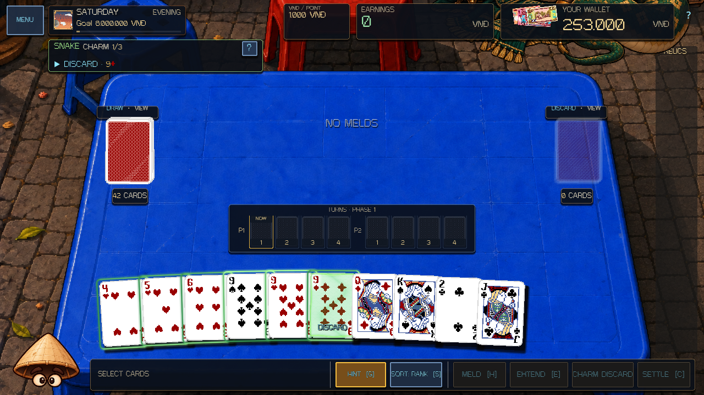
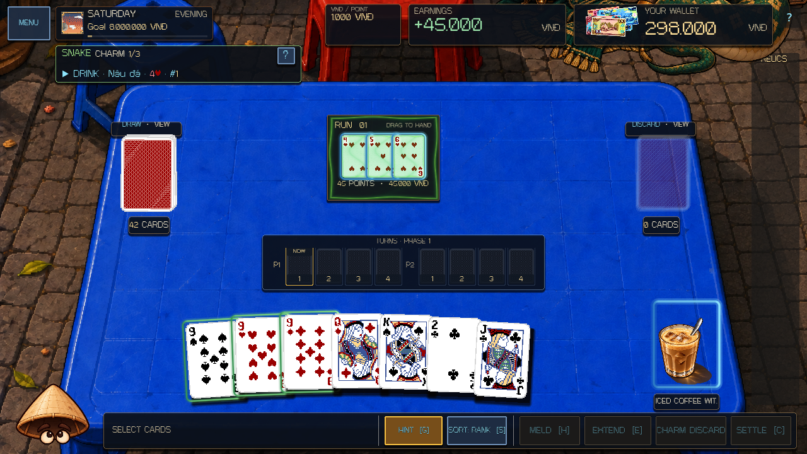
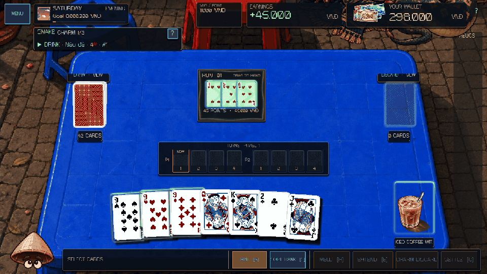

# Snake overhaul and deferred Dragon — 8–9 October 2026

Snake now issues consecutive charms with **one live target at a time**. PLEASED, NORMAL and UNPLEASED retain up to **1 / 2 / 3 charms per turn**. The next command is chosen from the committed hand and table after the current command resolves. Beginning a turn reveals a target without removing cards.

The shared boss panel shows only **CHARM i/n**, the current action, its target and **?**. Command selection is a convenience; the player commits through the normal Meld, Extend, Discard and Drink controls. Inspecting, selecting, sorting and rejected actions do not resolve a charm. Full rules remain behind **?**.

## Green charms and physical punishment

An animated serpent coil, scale pattern and green ribbon cover the charmed card faces with visible green ink. The effect follows the actual swaying face and stays visible in drag previews. Existing Meld targets receive green ink across the whole panel and every physical card, including their drag previews. An Extension charms its added hand card; the receiving Meld keeps its ordinary extension outline. Rank/suit corners remain readable; the underlying card-property material is preserved. Marks follow the current target and survive save/restore.

Disobedience discards the targeted loose card. If the target belongs to a Meld, **every card in that Meld is discarded**, including three-card Melds. The same rule covers existing table targets and a charmed card played into a new Meld. Already committed payments remain committed; losing the Meld removes its future extension and table value.

Charm discards use forced-discard records. Neither obedience nor disobedience increments the mandatory-discard count, refills the hand or ends the player turn. After the charms resolve, the ordinary mandatory discard still closes the turn. Trà đá skip and empty-hand end requests cannot bypass a pending charm.

Committed cards visibly coil and fly to the discard pile. A refused whole Meld moves as a group; any extra hand discard remains separate. Effects do not alter cards, wallet, scoring or RNG, and clear for menus, modals and boss changes.

## Dragon lockout

`ZodiacCatalog.DRAGON_ENABLED` is false. Dragon is absent from Boss Lab and cannot start or resume through its API. Finishing Snake proceeds to Saturday's normal collection, daily debt and Sunday. Existing campaign checkpoints at the Dragon choice or encounter resume at collection without granting a Dragon victory or ending. Dormant Dragon code and assets remain for the later update.

Legacy Snake saves retain committed history and the first pending charm; later targets are regenerated from the actual resulting table.

## Verification

Godot 4.7.1; isolated save profiles; validations run serially:

- Core: **404/404**.
- Rendered Snake: **907 checks, 0 failures**, both languages, all tiers, 960×620, 1280×720 and 1920×1080. Includes rendered pixel checks for visible green face ink, hand/Meld drag previews, ordinary Extension recipients, clearing resolved charms, actual pointer obedience/refusal, whole-Meld loss, independent discard flights, restoration and observational effects.
- Rendered roster presentation: **5,767/0**; full-roster runtime: **743/0**.
- Boss Lab navigation: **51/0**; independent-process sandbox write/read: **211/0 + 15/0**.
- Rendered runtime scene and physical card interaction (**43/0**) passed.
- Actual main scene booted in OpenGL compatibility for 120 frames. Final logs contain no Godot script, parse or runtime errors.
- Motion capture: **3/0**, including unchanged committed domain state after the animation. GIF timing uses the recorded effect clock to exclude PNG capture stalls.

Run `tools/validate_project.ps1 -Godot <console executable> -Only boss-snake -RenderedChecks boss-snake` for the focused scene check. Changes are local; prior NPC and Zodiac work is preserved.
